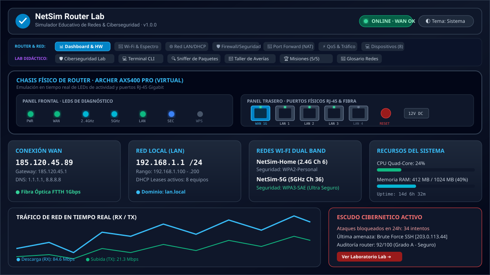
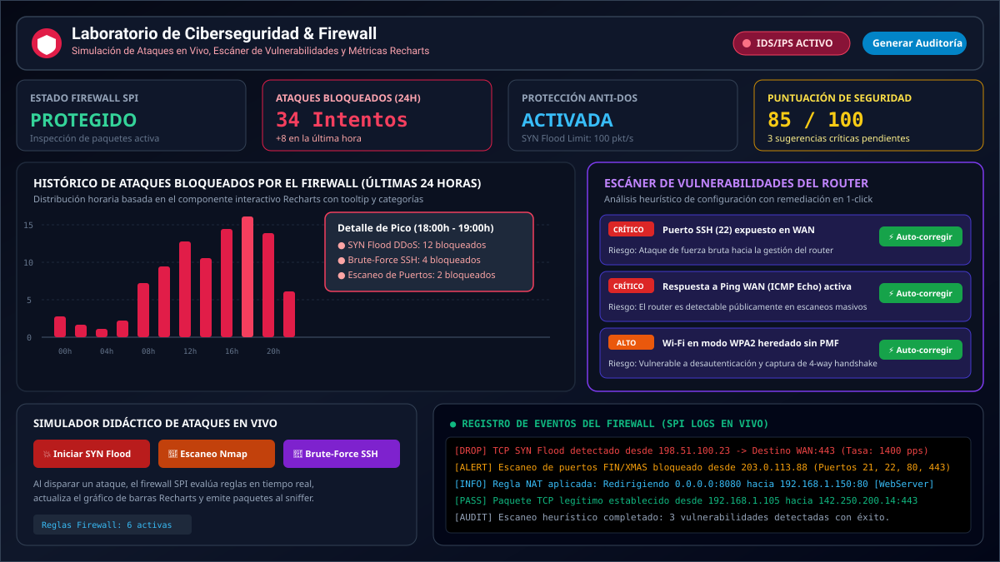
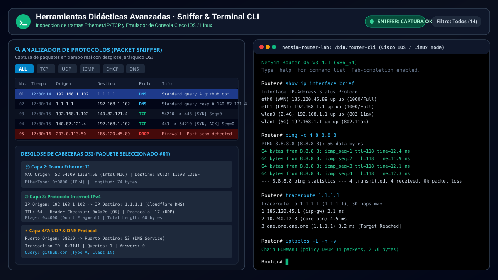

# 🌐 NetSim Router Lab

> **Simulador Interactivo y Didáctico de Configuración de Router, Redes y Ciberseguridad**  
> Diseñado para estudiantes, docentes, técnicos de soporte y entusiastas del networking y la seguridad informática.

[](https://react.dev/)
[](https://www.typescriptlang.org/)
[](https://tailwindcss.com/)
[](https://vitejs.dev/)
[](https://recharts.org/)
[](LICENSE)
[](https://github.com/unfantasmaenelsistema/NetSim-Router-Lab/actions/workflows/ci.yml)

### ▶️ Pruébalo online: **[https://unfantasmaenelsistema.github.io/NetSim-Router-Lab/](https://unfantasmaenelsistema.github.io/NetSim-Router-Lab/)**

Sin instalar nada: funciona íntegramente en el navegador (no envía datos a ningún servidor).

---

## 📸 Capturas de Pantalla & Showcase

### 1. Panel de Control & Emulación de Hardware Físico
Simulación en tiempo real del chasis del router con LEDs frontales de actividad (PWR, WAN, LAN, Wi-Fi 2.4/5G, SEC), puertos traseros RJ-45 Gigabit con estados de enlace, y métricas dinámicas de tráfico RX/TX.



---

### 2. Laboratorio de Ciberseguridad & Escáner de Vulnerabilidades
Histórico interactivo de ataques bloqueados en las últimas 24 horas usando **Recharts**, escáner heurístico de seguridad con **3 sugerencias críticas y botón de autorreparación (1-click auto-fix)**, simulador de ataques en vivo y registro de auditoría.



---

### 3. Analizador de Paquetes (Sniffer) & Terminal CLI Cisco / Linux
Inspección profunda de tramas con desglose jerárquico del modelo OSI (Capa 2 Ethernet, Capa 3 IPv4, Capa 4 TCP/UDP) y consola de comandos interactiva con utilidades reales de diagnóstico de red.



---

## 📑 Tabla de Contenidos

1. [Características Principales](#-características-principales)
2. [Pestañas y Módulos de la Aplicación](#-pestañas-y-módulos-de-la-aplicación)
3. [Comandos de la Terminal CLI](#-comandos-de-la-terminal-cli)
4. [Casos de Uso Educativos](#-casos-de-uso-educativos)
5. [Tecnologías Utilizadas](#-tecnologías-utilizadas)
6. [Estructura del Proyecto](#-estructura-del-proyecto)
7. [Instalación y Puesta en Marcha](#-instalación-y-puesta-en-marcha)
8. [Despliegue](#-despliegue)
9. [Licencia](#-licencia)

---

## ✨ Características Principales

- **🎮 Simulación Realista sin Riesgo:** Experimenta con configuraciones críticas de red doméstica y empresarial sin temor a dejar sin conexión tu equipo físico.
- **🛡️ Laboratorio de Ciberseguridad Avanzado:**
  - Gráfico de barras temporal con histórico de ataques bloqueados por hora (SYN Flood, Port Scan, Brute-Force SSH, DNS Poisoning).
  - Escáner de vulnerabilidades del router con evaluación de configuración actual y recomendaciones automáticas de mitigación.
  - Simulador didáctico de ataques con respuesta en tiempo real del firewall SPI.
- **🔍 Packet Sniffer al estilo Wireshark:** Captura tráfico en vivo y visualiza las cabeceras binarias y campos de protocolo de cada trama.
- **💻 Terminal CLI con dos modos:** diagnóstico desde cualquier equipo de la casa (`ping`, `traceroute`, `nslookup`, `arp`, `curl`…) y **consola de administración del router** con comandos estilo Cisco IOS / Linux (`show ip interface brief`, `iptables`, `netstat`, `show dhcp leases`…). Las respuestas salen de la configuración real del simulador: DNS caído, pool DHCP agotado, aislamiento de invitados o firewall se notan en la terminal.
- **🧠 Motor de red coherente:** servidor DHCP con pool y reservas reales (APIPA 169.254.x.x cuando no hay concesión), QoS por prioridad que respeta el ancho de banda contratado, interferencias Wi-Fi por canal y ancho, control parental que corta el tráfico y aislamiento de invitados en capa 2.
- **🔧 Taller de Averías (Helpdesk Break & Fix):** 5 escenarios prácticos: al simular la avería el síntoma aparece de verdad en la red y en la terminal, y el caso solo cuenta como resuelto cuando lo arreglas.
- **🎯 Sistema de Misiones Gamificado:** Retos formativos paso a paso con celebración de confeti al cumplir los objetivos.
- **🌓 Selector de Tema Global (Claro / Oscuro / Sistema):** Adaptabilidad visual fluida con persistencia en `localStorage`.
- **📱 Cinta de Navegación de Doble Fila:** Distribución clara y ergonómica sin necesidad de scroll horizontal.

---

## 🧭 Pestañas y Módulos de la Aplicación

La navegación está dividida en dos filas temáticas para una máxima accesibilidad:

### Fila 1 · Configuración de Red & Router
| Módulo | Descripción |
| :--- | :--- |
| **📊 Dashboard & Hardware** | Estado de la conexión WAN, red LAN, clientes activos, monitor de tráfico RX/TX y emulador de chasis físico con puertos y LEDs. |
| **📶 Wi-Fi & Espectro** | Ajustes de SSID, seguridad (WPA2/WPA3), canal, ancho de banda y analizador de espectro radioeléctrico 2.4 GHz y 5 GHz. |
| **🌐 Red LAN & DHCP** | Dirección IP de pasarela, máscara de subred (/24, /23, /16), pool de asignación DHCP y reservas estáticas de IP por MAC. |
| **🛡️ Seguridad & Firewall** | Reglas de filtrado SPI, protección anti-DoS, bloqueo de Ping WAN (ICMP), y control de acceso parental/por URL. |
| **🔄 Port Forwarding (NAT)** | Reglas de redirección de puertos WAN hacia hosts de la LAN, DMZ (Zona Desmilitarizada) y gestión de UPnP. |
| **⚡ QoS & Tráfico** | Priorización de ancho de banda por categorías de tráfico (VoIP, teletrabajo, juegos, descargas). |
| **💻 Dispositivos Conectados** | Inventario de equipos en la red local (PCs, móviles, consolas, IoT), gestión de permisos y bloqueo MAC. |

### Fila 2 · Laboratorio & Taller Didáctico
| Módulo | Descripción |
| :--- | :--- |
| **🛡️ Ciberseguridad Lab** | Centro de pruebas de ciberdefensa: gráfico Recharts de 24h, escáner de vulnerabilidades y simulador de ataques. |
| **💻 Terminal CLI** | Terminal de cada equipo (diagnóstico) y consola de administración del router (estado, firewall, NAT, DHCP, Wi-Fi). |
| **🔍 Sniffer de Paquetes** | Monitor de paquetes con filtros por protocolo (TCP, UDP, ICMP, DNS, DHCP) e inspección de capas OSI. |
| **🔧 Taller de Averías** | 5 casos: pool DHCP agotado, DNS caído, regla NAT mal configurada, interferencias en 2.4 GHz y DMZ + firewall desactivado. |
| **🏆 Misiones Didácticas** | Desafíos interactivos guiados con validación automática y recompensas visuales. |
| **📖 Glosario de Redes** | Diccionario técnico interactivo con términos clave de telecomunicaciones y ciberseguridad. |

---

## 💻 Comandos de la Terminal CLI

En el selector **«Ejecutar en»** eliges desde dónde lanzas los comandos. `Tab` autocompleta y `↑`/`↓` recorren el historial.

### Desde un equipo de la red (PC, móvil, TV, cámara…)

```bash
help                      # lista de comandos
ipconfig                  # IP, máscara, gateway, DNS y origen de la dirección (alias: ifconfig)
arp -a                    # tabla ARP del equipo
ping 8.8.8.8              # conectividad e RTT (también "ping gateway" o un nombre de dominio)
traceroute 1.1.1.1        # saltos hasta el destino (alias: tracert)
nslookup google.com       # resolución DNS (alias: dig)
curl -I http://example.com
speedtest
clear
```

### Desde la «Consola del Router»

```bash
show ip interface brief   # interfaces WAN / LAN / Wi-Fi y su estado
show arp
show dhcp leases          # pool, concesiones y clientes sin IP (alias: dhcp-leases)
show running-config
iptables -L -n -v         # reglas del firewall
iptables -t nat -L -n -v  # Port Forwarding, DMZ y MASQUERADE
netstat -tuln             # servicios escuchando en el router
wifi-status               # radios, canales, seguridad y WPS
ping / traceroute / nslookup
system-reboot             # reinicia el router (alias: reload)
```

---

## 🎓 Casos de Uso Educativos

- **Formación Profesional y Grados en Informática:** Ideal para módulos de Redes Locales, Seguridad Informática y Servicios de Red (FP SMR, ASIR, DAM, DAW).
- **Certificaciones Oficiales:** Excelente herramienta de apoyo visual para preparar certificaciones como:
  - **Cisco CCNA (200-301)**
  - **CompTIA Network+ (N10-008 / N10-009)**
  - **CompTIA Security+ (SY0-701)**
- **Talleres de Ciberseguridad Escolar y Universitaria:** Permite a los alumnos entender el impacto de abrir puertos peligrosos o deshabilitar el firewall sin consecuencias reales.

---

## 🛠️ Tecnologías Utilizadas

- **Core:** [React 19](https://react.dev/) + [TypeScript](https://www.typescriptlang.org/)
- **Estilos & Diseño:** [Tailwind CSS v4](https://tailwindcss.com/)
- **Visualización de Datos:** [Recharts](https://recharts.org/)
- **Iconografía:** [Lucide React](https://lucide.dev/)
- **Efectos y Animaciones:** [Canvas-Confetti](https://www.npmjs.com/package/canvas-confetti)
- **Bundler & Dev Server:** [Vite 8](https://vitejs.dev/)

---

## 📂 Estructura del Proyecto

```text
NetSim-Router-Lab/
├── .github/workflows/ci.yml        # Typecheck + build con Bun y despliegue en GitHub Pages
├── docs/screenshots/               # Capturas y diagramas vectoriales para el README
├── public/icono.png                # Favicon e icono de la aplicación
├── src/
│   ├── components/
│   │   ├── tabs/                   # Pestañas principales
│   │   │   ├── DashboardTab.tsx
│   │   │   ├── WirelessTab.tsx
│   │   │   ├── NetworkLanTab.tsx       # LAN, DHCP (con validación) y DNS
│   │   │   ├── SecurityFirewallTab.tsx
│   │   │   ├── PortForwardingTab.tsx
│   │   │   ├── QosTab.tsx
│   │   │   ├── VirtualDevicesTab.tsx
│   │   │   ├── SecurityLabTab.tsx      # Laboratorio de ciberseguridad
│   │   │   ├── MissionsTab.tsx
│   │   │   └── GlossaryTab.tsx
│   │   ├── Header.tsx                  # Cabecera, selector de tema y navegación en 2 filas
│   │   ├── NetworkCliTerminal.tsx      # Interfaz de la terminal
│   │   ├── PacketSnifferView.tsx       # Analizador de paquetes por capas OSI
│   │   ├── TroubleshootingLab.tsx      # Taller de averías
│   │   ├── VulnerabilityScanner.tsx    # Escáner con autorreparación
│   │   ├── RouterHardwareView.tsx      # Chasis físico, LEDs y puertos RJ-45
│   │   ├── ActivityLogDrawer.tsx       # Registro de actividad
│   │   ├── AuditReportModal.tsx        # Informe de auditoría imprimible
│   │   └── ErrorBoundary.tsx           # Recuperación si una pestaña falla al cargar
│   ├── simulation/
│   │   ├── networkEngine.ts            # Motor: DHCP, QoS, Wi-Fi, DoS y auditoría de seguridad
│   │   ├── cliEngine.ts                # Comandos de la terminal y de la consola del router
│   │   └── netUtils.ts                 # Utilidades IPv4, subredes, DNS y pool DHCP
│   ├── data/                           # Configuración por defecto, equipos, misiones, glosario
│   ├── hooks/useTheme.ts               # Tema claro / oscuro / sistema con localStorage
│   ├── types/router.ts                 # Tipos del estado del router
│   ├── App.tsx                         # Estado global y bucle de simulación
│   └── index.css                       # Tailwind v4 y paleta del tema claro
├── package.json
├── bun.lock
├── tsconfig.json
└── vite.config.ts                      # base './' para servirse desde cualquier subruta
```

---

## 🚀 Instalación y Puesta en Marcha

### Prerrequisitos
- [Bun](https://bun.sh/) 1.x (recomendado: el proyecto incluye `bun.lock`) o [Node.js](https://nodejs.org/) 20+ con npm

### Pasos

1. **Clonar el repositorio:**
   ```bash
   git clone https://github.com/unfantasmaenelsistema/NetSim-Router-Lab.git
   cd NetSim-Router-Lab
   ```

2. **Instalar dependencias:**
   ```bash
   bun install
   ```

3. **Iniciar servidor de desarrollo:**
   ```bash
   bun run dev
   ```
   Abre tu navegador en [http://localhost:3000](http://localhost:3000).

4. **Compilar para producción:**
   ```bash
   bun run build
   ```
   Los archivos optimizados se generan en `dist/` con rutas relativas, así que puedes subir esa carpeta a cualquier hosting estático o subcarpeta.

5. **Validar tipos:**
   ```bash
   bun run lint
   ```

Con npm los comandos equivalentes son `npm install`, `npm run dev`, `npm run build` y `npm run lint`.

---

## 🌍 Despliegue

Cada push a `main` ejecuta [`.github/workflows/ci.yml`](.github/workflows/ci.yml): comprobación de tipos, build con Vite y publicación automática en **GitHub Pages**:

**https://unfantasmaenelsistema.github.io/NetSim-Router-Lab/**

Los pull requests solo pasan el typecheck y el build (no despliegan).

---

## 📄 Licencia

Distribuido bajo la Licencia **MIT**. Consulta el archivo [`LICENSE`](LICENSE) para más detalles.

---

<p align="center">
  Desarrollado con fines educativos para la divulgación de redes y ciberseguridad. 🛡️💻
</p>
